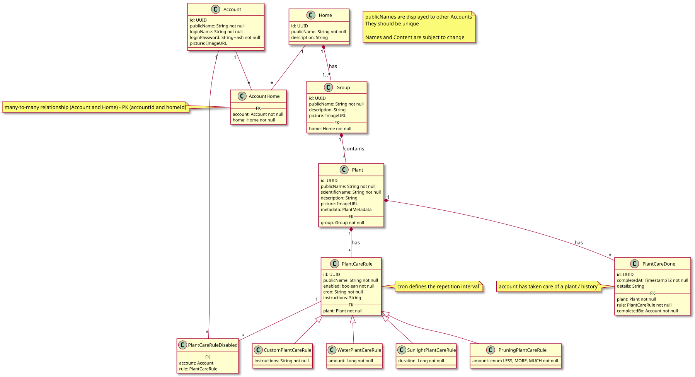

# powerplants

Eine intelligente Pflanzenpflege-App für den privaten Haushalt, die es den Nutzern ermöglicht, den Zustand und das Wachstum ihrer Pflanzen zu überwachen. Dabei werden zusätzliche Pflegeempfehlungen geliefert. Haushalte mit Pflanzen sollen damit von mehreren Benutzern gemeinsam koordiniert werden können. Dabei sollen auch soziale Aspekte (durch die Unterstützung von mehreren Benutzern) integriert werden, um den Austausch und die Pflege gemeinsamer Pflanzen zu fördern.

## Allgemeine Regeln
- Kein force push!
- Issues haben unterschiedliche Status (Todo, In Progress, Verify, Done)
- Englischer Code
- Linter und Formatter für das Frontend
- Formatter für das Backend (Java und dart)
- Merge Request für fertige Feature-Branches die in den Development gemerged werden müssen.

## Branch-Richtlinien
Für das Projekt werden 3 Typen von Branches verwendet:

- **Main Branch**: Der Main Branch beinhaltet ausgeschlossen lauffähige und Versionen, die abegegeben werden könnten. Merges in diesen Branch erfolgen nur nach gemeinsamer Absprache.

- **Development Branch**: Hauptentwicklungs-Branch. Hier werden nur abgeschlossene Feature-Branches gemerged. Der Branch muss stets lauffähig sein, auch wenn noch keine finale Version vorliegt.

- **Feature Branches**: Werden aus dem aktuellen development-Branch automatisch über ein Issue/Merge-Request erstellt. Nach Abschluss des Issues erfolgt ein Merge-Request, der von einem anderen Gruppenmitglied geprüft und anschließend in development-Branch gemerged wird.

Konventionen zu Branch-Namen: TBD

## Comitt Richtilinien
Comitt-Messages werden englisch und im Präsens verfasst. 

z.B. "create flutter frontend", "update targets", "implement adaptive color theme"

## Figma Screens Mockup
https://www.figma.com/design/yY0zIon9shO64RLj2AyRJO/Powerplants?node-id=0-1&t=SAmsJB3BudRhEGNW-1

https://www.figma.com/design/yquM6kJgzYgQPbqG3KBEhm/Programmierprojekt?node-id=0-1&m=dev&t=Uy8TVn9Hz2ZK4Ery-1

## Entity Relationship Model

